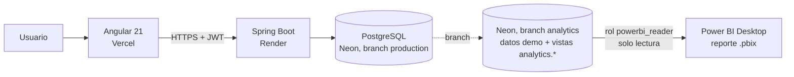
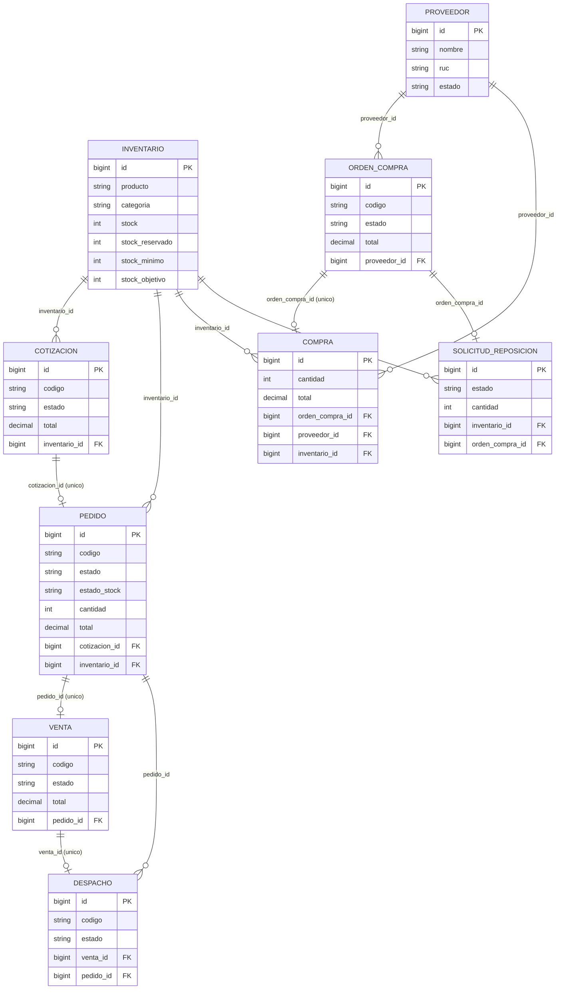
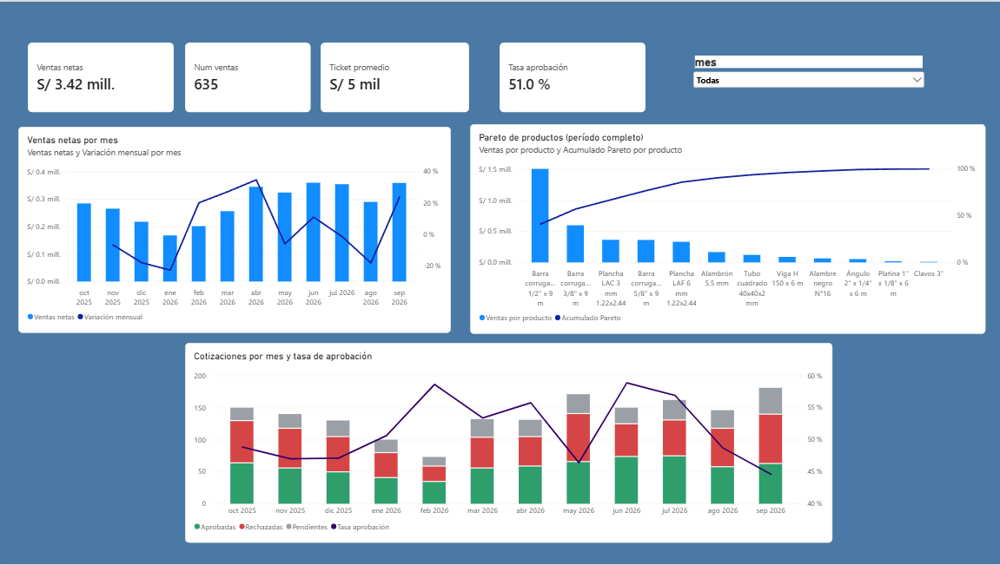
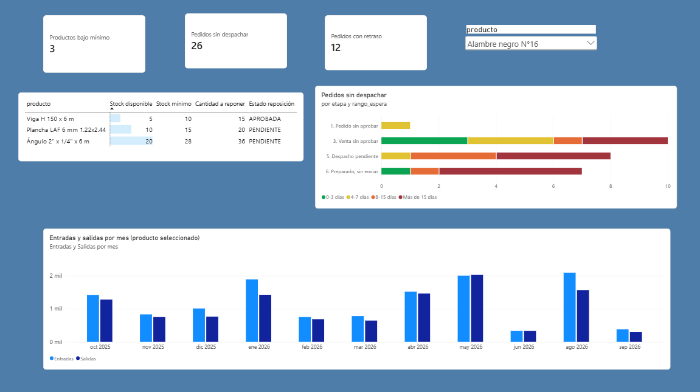

# SIDERURGICA-ERP

Sistema ERP académico para la gestión comercial, logística y de recursos humanos de una empresa siderúrgica.

## Demo desplegada

- Frontend Angular: [https://siderurgica-erp.vercel.app](https://siderurgica-erp.vercel.app)
- Backend Spring Boot: [https://siderurgica-erp.onrender.com](https://siderurgica-erp.onrender.com)
- Base de datos: PostgreSQL en Neon

> Proyecto demostrativo desarrollado para el curso de Desarrollo Web del séptimo ciclo. No representa un sistema productivo oficial.
> El backend está en el plan gratuito de Render: si estuvo inactivo, la primera carga puede tardar unos 50 segundos.

## Módulos

- Autenticación y autorización por roles
- Ventas, cotizaciones y pedidos
- Despachos e inventario
- Abastecimiento y proveedores
- Recursos humanos, asistencia y planillas
- Reportes e indicadores
- Administración de usuarios

## Tecnologías

| Capa | Tecnologías | Despliegue |
|---|---|---|
| Frontend | Angular 21, TypeScript, RxJS, SCSS | Vercel |
| Backend | Java 17, Spring Boot, Spring Security, JPA, JWT | Render |
| Datos | PostgreSQL | Neon |

## Estructura del repositorio

```text
SIDERURGICA-ERP/
├── FRONTEND/   # aplicación Angular
└── BACKEND/    # API REST Spring Boot
```

Consulta la documentación específica:

- [Documentación del frontend](FRONTEND/README.md)
- [Documentación del backend](BACKEND/README.md)

## Ejecución local

Backend:

```powershell
cd BACKEND
$env:DB_URL="jdbc:postgresql://HOST/BASE_DE_DATOS?sslmode=require"
$env:DB_USERNAME="USUARIO"
$env:DB_PASSWORD="CONTRASENA"
$env:JWT_SECRET="SECRETO_DE_AL_MENOS_32_CARACTERES"
mvn spring-boot:run
```

Frontend, en otra terminal:

```powershell
cd FRONTEND
npm ci
npm start
```

- Frontend local: `http://localhost:4200`
- Backend local: `http://localhost:3000`

## Seguridad

El repositorio no contiene credenciales reales. Las claves de Neon y JWT deben configurarse como variables privadas de Render o variables locales del sistema.

## Analítica

Reporte de Power BI de dos páginas (comercial e inventario) sobre una **branch de Neon dedicada a analítica**, con datos de demostración generados por script. La base de producción del ERP no se toca.

### Arquitectura



### Modelo de datos (flujo comercial, inventario y compras)

Las relaciones son las que usa el backend; cada documento corresponde a un solo producto de inventario.



### Reglas de negocio que reflejan los indicadores

- Una cotización aprobada pasa de inmediato a `CONVERTIDA` y genera su pedido, por lo que **aprobada = `APROBADA` + `CONVERTIDA`**.
- Aprobar un pedido **reserva** stock (`stock_reservado`) y crea la venta. El stock físico solo baja cuando el despacho pasa a `ENVIADO`.
- Stock disponible = `stock - stock_reservado`. Hay bajo stock cuando el disponible es menor o igual al mínimo, y eso genera una solicitud de reposición.

### Indicadores

| Vista (`analytics.*`) | Qué responde | Visual |
|---|---|---|
| `v_ventas_mensual` | ¿Cuánto vendemos y cómo varía cada mes? | Columnas y línea de variación |
| `v_top_productos` | ¿Qué productos concentran las ventas? (Pareto) | Columnas y línea acumulada |
| `v_cotizaciones_estado` | ¿Cuántas cotizaciones se aprueban frente a las que se rechazan? | Columnas apiladas y tasa |
| `v_stock_bajo_minimo` | ¿Qué productos hay que reponer ya? | Tabla con barras de datos |
| `v_pedidos_sin_despachar` | ¿Dónde están detenidos los pedidos y desde cuándo? | Barras apiladas por etapa y antigüedad |
| `v_movimientos_stock` | ¿Cuánto entra y sale de cada producto por mes? | Columnas agrupadas por producto |

### Capturas

Los valores corresponden a los datos de demostración y cambian si se vuelve a ejecutar el script de datos.

#### Página 1: Comercial



- **Tarjetas:** ventas netas, número de ventas, ticket promedio y tasa de aprobación de cotizaciones.
- **Ventas netas por mes:** columnas con la variación mensual en línea. Se excluye el mes en curso por estar incompleto.
- **Pareto de productos:** muestra que pocos productos concentran la mayor parte de las ventas. Cubre todo el período y no responde al filtro de mes.
- **Cotizaciones por mes:** aprobadas, rechazadas y pendientes, con la tasa de aprobación (aprobadas sobre aprobadas más rechazadas).

#### Página 2: Inventario



- **Tarjetas:** productos bajo el stock mínimo, pedidos sin despachar y pedidos con más de 15 días de espera.
- **Tabla de reposición:** productos cuyo stock disponible (stock menos reservado) está en o bajo el mínimo, con la cantidad a reponer y el estado de su solicitud.
- **Pedidos sin despachar:** etapa donde está detenido cada pedido y su antigüedad, de verde (0-3 días) a rojo (más de 15 días).
- **Entradas y salidas por mes:** compras recibidas frente a despachos enviados del producto elegido en la segmentación. Se filtra por producto porque las unidades difieren (kg, varillas, planchas).

### Cómo reproducirlo

1. En Neon, crea una branch `analytics` desde `production` (sin auto-borrado) y aplica `BACKEND/migrations/001_automatizacion.sql` si aún no está.
2. En el SQL Editor de esa branch, ejecuta en orden los scripts de `BACKEND/analytics/`:
   - `01_seed_demo.sql`: borra los datos operativos de la branch y genera 13 meses de actividad. Usar **solo** en la branch de analítica.
   - `02_views.sql`: crea el esquema `analytics` con las seis vistas.
   - `03_reader_role_neon_editor.sql`: crea el rol `powerbi_reader` (solo lectura sobre `analytics`). Reemplaza el marcador de contraseña antes de ejecutar y no lo guardes en el repositorio.
3. Abre `docs/analytics/siderurgica.pbix`, conecta con el rol `powerbi_reader` y pulsa **Actualizar**.

### Notas

- Todos los datos son ficticios (empresas, RUC y montos).
- El mes en curso está incompleto, por lo que el reporte lo excluye con `Meses[Mes completo]`. El Pareto abarca todo el período y no responde al filtro de mes.
- No existe una tabla de movimientos de stock: entradas y salidas se derivan de `compra` y `despacho`. Los ajustes manuales de inventario no aparecen en ese indicador.
- El archivo `.pbix` se guarda sin credenciales; Power BI las pedirá al actualizar.